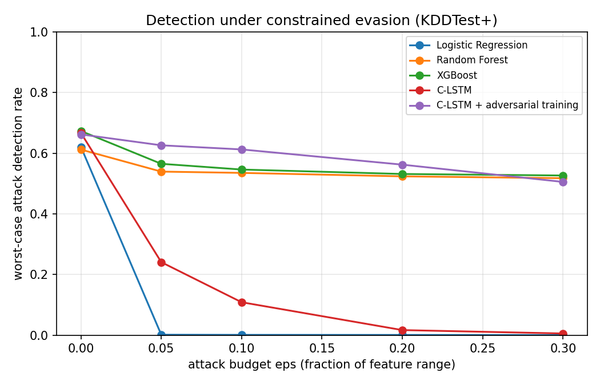

# Multi-Class Network Intrusion Detection on NSL-KDD

Hybrid CNN-LSTM (C-LSTM) intrusion detection on NSL-KDD, compared against Random Forest, Logistic Regression and gradient-boosted baselines, with a focus on rare-attack detection and adversarial robustness.

> **Status:** baseline and adversarial-robustness results complete. Next: SHAP explanations.

## Background
Originally built as a team project for NC State's Neural Networks & Deep Learning course (Spring 2026) and presented at the NC State AI Student Symposium 2026. Team: Asavari Hangal, Nidhi Grover, Arnav Yennam.
This repository is my independent rebuild and extension of that work. The original course notebooks are kept unchanged in `notebooks/*_original.ipynb` for reference.

## Evaluation protocol
- **Train:** KDDTrain+ (stratified 10% held out for validation). **Test:** the official **KDDTest+** split, used once per seed.
- **Tasks:** 5-category (Normal / DoS / Probe / R2L / U2R) and binary (attack vs. normal). KDDTest+ contains 17 attack types that never appear in training, so 23-class labels can't be evaluated on it.
- **Preprocessing** (one-hot, log1p on byte/duration features, scaling) and capped SMOTE are fit on training data only.
- **Model selection:** each model's hyperparameters are chosen on validation macro-F1 only; the chosen config is then re-trained with 3 seeds and reported as mean ± std.
- **Metrics:** accuracy, macro-F1, weighted F1, per-class precision/recall, attack detection rate, false-positive rate, attack ROC-AUC, and **novel-attack detection rate** (share of test attacks unseen in training that are still flagged as attacks).

## Quickstart
```bash
pip install -r requirements.txt
bash data/download_data.sh
python -m src.run --task 5class --quick     # ~5 min smoke test
python -m src.run --task 5class             # full run (GPU recommended for C-LSTM)
python -m src.run --task binary
```
Results land in `results/<task>/` (`results.md`, `summary.csv`, `per_seed.json`, `chosen_configs.json`). On Colab, use `notebooks/03_run_pipeline.ipynb`.

## Roadmap
- [x] Single pipeline in `src/`; every reported number comes from one run
- [x] Official KDDTest+ evaluation, 5-category and binary
- [x] Validation-only model selection; multi-seed reporting
- [x] Baselines: Logistic Regression, Random Forest, XGBoost
- [x] Novel-attack (zero-day) detection rate
- [x] Adversarial robustness: constrained white-box PGD, black-box query attack, transfer, adversarial training
- [ ] SHAP explanations per attack category

## Results (KDDTest+, mean ± std over 3 seeds)

**5-category (Normal / DoS / Probe / R2L / U2R)**

| Model | Accuracy | Macro-F1 | Attack detection | False-positive rate | Attack AUC | Novel-attack detection |
|---|---|---|---|---|---|---|
| Logistic Regression | 0.768 ± 0.004 | 0.550 ± 0.003 | 0.694 ± 0.003 | 0.048 ± 0.011 | 0.930 ± 0.002 | **0.392 ± 0.010** |
| Random Forest | 0.749 ± 0.008 | 0.542 ± 0.011 | 0.597 ± 0.013 | **0.026 ± 0.000** | 0.963 ± 0.001 | 0.181 ± 0.032 |
| XGBoost | **0.783 ± 0.004** | **0.611 ± 0.014** | 0.665 ± 0.010 | 0.028 ± 0.000 | **0.966 ± 0.002** | 0.364 ± 0.024 |
| C-LSTM | 0.768 ± 0.021 | 0.582 ± 0.065 | 0.669 ± 0.011 | 0.045 ± 0.027 | 0.952 ± 0.013 | 0.323 ± 0.037 |

Per-class recall:

| Model | Normal | DoS | Probe | R2L | U2R |
|---|---|---|---|---|---|
| Logistic Regression | 0.952 | 0.794 | 0.731 | 0.125 | 0.408 |
| Random Forest | 0.974 | 0.780 | 0.601 | 0.049 | 0.169 |
| XGBoost | 0.972 | 0.834 | 0.676 | 0.115 | 0.289 |
| C-LSTM | 0.955 | 0.794 | 0.693 | 0.144 | 0.323 |

**Binary (attack vs. normal)**

| Model | Accuracy | Macro-F1 | Attack detection | False-positive rate | Attack AUC | Novel-attack detection |
|---|---|---|---|---|---|---|
| Logistic Regression | 0.754 ± 0.001 | 0.753 ± 0.001 | 0.625 ± 0.002 | 0.077 ± 0.000 | 0.772 ± 0.004 | 0.411 ± 0.009 |
| Random Forest | 0.771 ± 0.012 | 0.770 ± 0.012 | 0.618 ± 0.021 | 0.027 ± 0.000 | 0.960 ± 0.001 | 0.250 ± 0.073 |
| XGBoost | 0.796 ± 0.009 | 0.795 ± 0.009 | 0.663 ± 0.016 | 0.029 ± 0.000 | 0.968 ± 0.003 | 0.388 ± 0.052 |
| C-LSTM | 0.786 ± 0.010 | 0.786 ± 0.010 | 0.645 ± 0.017 | 0.027 ± 0.001 | 0.955 ± 0.009 | 0.300 ± 0.058 |

Full outputs: `results/5class/`, `results/binary/`.

### Findings
- **Random splits hide the real difficulty.** On a random split of KDDTrain+, every model scores ~99% accuracy (the original course notebook reported this). On the official KDDTest+ split, accuracy drops to 75–80%, and validation macro-F1 (0.95–0.97 for the tree models and C-LSTM) falls to 0.54–0.61 on test.
- **XGBoost is the strongest model overall** (best accuracy, macro-F1 and AUC on both tasks). The C-LSTM is competitive (second on binary accuracy) but less stable across seeds (macro-F1 std 0.065).
- **Novel attacks are the main failure mode.** Only 18–41% of test attacks never seen in training are flagged. R2L recall stays below 15% for every model, because most KDDTest+ R2L traffic comes from unseen attack types.
- **Simpler models generalize better to unseen attacks.** Logistic Regression has the best novel-attack detection (0.39–0.41) despite lower overall accuracy; Random Forest has the lowest false-positive rate but misses the most novel attacks.

## Adversarial robustness
Can an attacker change their traffic so the detector labels it normal? `src/run_adversarial.py` tests the binary (attack vs. normal) detectors under **realistic, constrained** evasion attacks.

**Threat model**
- The attacker controls their own connections but must keep the attack working. Following IDSGAN (Lin et al.), features that carry the attack ("functional" features) are frozen per category: intrinsic and time-based traffic features for DoS/Probe, and intrinsic and content features for R2L/U2R. The attacker may only change the remaining groups (17–19 features).
- Protocol, service, flag and binary flags are never changed. Every modified value is snapped back to a valid raw value: rates stay in [0, 1], and counts and bytes stay non-negative integers no larger than seen in training. Each run asserts these constraints on every adversarial example.
- Budget `eps`: the maximum change per modifiable feature, as a fraction of its valid range (0.05–0.3).

**Attacks**, reported as the **worst case per connection** (it evades if any attack succeeds):
- **White-box PGD** (40 steps, margin loss toward "normal", from both a random and a zero start) on every differentiable model.
- **Black-box, query-based random search** (300 iterations, scores only) on every model, including the tree models.
- **Transfer** of examples crafted on the other differentiable models.

Why worst case: in a first run, PGD with a random start alone reported the adversarially trained model detecting *more* attacks under attack than without (0.72 vs 0.69), which is a sign of an overly weak attack (gradient masking), not real robustness. Zero-start PGD and black-box queries break through it, so only the worst case over all attacks is reported.

**Defense:** PGD adversarial training of the C-LSTM (Madry et al.) with the same constraints, at `eps = 0.1`.

Run: `python -m src.run_adversarial` (GPU recommended; `notebooks/04_adversarial_kaggle.ipynb` for Kaggle). Outputs go to `results/adversarial/`.

**Results** (worst-case attack detection rate on the 12,833 KDDTest+ attacks; full tables in [`results/adversarial/results.md`](results/adversarial/results.md))

| Model | Clean | eps=0.05 | eps=0.1 | eps=0.2 | eps=0.3 |
|---|---|---|---|---|---|
| Logistic Regression | 0.621 | 0.001 | 0.001 | 0.001 | 0.000 |
| Random Forest | 0.612 | 0.539 | 0.535 | 0.524 | 0.518 |
| XGBoost | 0.673 | 0.565 | 0.546 | 0.532 | 0.527 |
| C-LSTM | 0.667 | 0.241 | 0.109 | 0.017 | 0.005 |
| **C-LSTM + adversarial training** | 0.662 | **0.626** | **0.612** | **0.562** | 0.505 |



**Findings**
- **The standard C-LSTM is easy to evade.** Changing only non-functional features by up to 10% of their range cuts its detection from 66.7% to 10.9%, and at 20% almost every attack gets through (1.7%). Logistic regression collapses at the smallest budget.
- **Adversarial training closes most of the gap at almost no cost.** At the training budget (eps = 0.1), worst-case detection goes from 10.9% to 61.2% (5.6×), and clean accuracy and false-positive rate are essentially unchanged (79.6% vs 79.8%, FPR 2.7% vs 2.8%). It is the most robust model up to eps = 0.2, and degrades gradually beyond the budget it was trained on.
- **Tree models are naturally harder to evade but still lose ground.** XGBoost drops from 67.3% to 52.7% under black-box queries. Their piecewise-constant decision surfaces give gradient-free attackers less signal.
- **The strongest attack differs per model.** On the C-LSTM, black-box queries (12.0% detection at eps = 0.1) beat white-box PGD (20.5%). Evaluating with a single gradient attack would have overstated robustness. (A first run that used only random-start PGD reported the adversarially trained model at 72%, *above* its clean rate. That was a sign of a failed attack, which is why only worst-case numbers are reported.)
- **R2L and U2R attacks become nearly undetectable for every model under attack** (≤ 21% at eps = 0.2), while DoS and Probe stay detectable for the robust models (66–73%). Stealthy attacks remain the weak spot.

**Limitations:** one seed; black-box attacks limited to 300 queries per connection (a stronger attacker could do better); the feature-level threat model is a proxy for packet-level manipulation.

**Limitation:** budgets on min-max-scaled features allow large absolute changes on heavy-tailed counts (e.g. `num_root`). That is standard in the NIDS adversarial literature, but it's still a simplification of what's physically achievable on the wire.

## Repository layout
```
data/        download script (data not committed)
notebooks/   original course notebooks + new analysis notebooks
src/         pipeline: data.py, models.py, evaluate.py, run.py
results/     figures and metrics
docs/        symposium poster
```
